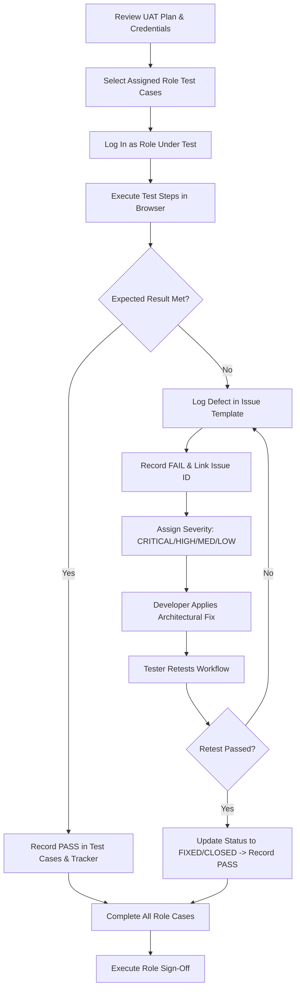

# NatureAide User Acceptance Testing (UAT) Plan

**Platform**: NatureAide — Evidence-Based Herbal Medicine & Botanical Research Platform  
**Target Milestone**: Controlled Pilot Preparation  
**Document Version**: 1.0.0  
**Effective Date**: October 26, 2026  
**Status**: ACTIVE / READY FOR EXECUTION  

---

## 1. Purpose

The purpose of this User Acceptance Testing (UAT) Plan is to provide a structured, rigorous, and verifiable framework for evaluating the NatureAide platform from the perspective of real human stakeholders:
- **Community Users**: Citizens seeking verified educational guidance and registered Philippine herbal products.
- **Researchers**: Scientists conducting multi-stage botanical research, in-silico investigations, formulation prototyping, and laboratory validation.
- **Health Professionals / Reviewers**: Licensed clinicians, pharmacologists, pharmacists, and ethnobotanists conducting independent scientific evaluation of research dossiers.
- **System Administrators**: Governance officers managing reviewer verification, user account lifecycles, knowledge base integration, and audit tracking.

This testing phase shifts the focus from automated code verification to **human-centric operational acceptance**, validating end-to-end task completion, clinical usability, scientific rigor, and role-based boundaries.

---

## 2. UAT Objectives

1. **Verify Role Workflows**: Validate that each role (Community, Researcher, Reviewer, Admin) can perform their real-world responsibilities smoothly and without technical blockades.
2. **Validate Scientific Governance**: Ensure that research cannot bypass independent professional review, that formulation prototypes cannot masquerade as community preparations, and that only admin-approved integrated knowledge updates the public knowledge base.
3. **Verify Community Safety**: Confirm that health screening appropriately guides users, that medical advice/prescriptions are never generated, and that Ask NatureAide AI strictly adheres to zero-fabrication grounding.
4. **Enforce Role Independence**: Verify that reviewers remain independent evaluators without scientific content editing rights, and that administrators cannot unilaterally alter researcher findings.
5. **Ensure Usability Across Devices**: Verify that priority interfaces are readable, intuitive, and responsive across mobile (375px, 390px, 430px), tablet, and desktop viewports.
6. **Establish Role Sign-Off**: Provide documented accountability and formal acceptance recommendations from designated representatives for each user tier.

---

## 3. Scope

### In-Scope Modules:
- **Community Tier**:
  - Landing & Monograph Catalog (`/community/herbal-guide`, `/community/plants/[slug]`)
  - Traditional Preparation Guides (`/community/plants/[slug]/preparation`)
  - Commercial Registered Herbal Products (`/community/products`, `/community/products/[slug]`)
  - Ask NatureAide Grounded AI Assistant (`/community/ask`)
  - Community Health Screening & Triage Flow (`/community/screening`, `/community/guidance`, `/community/facilities`)
  - User Profile & Saved Items (`/community/profile`, `/community/saved`)
- **Researcher Tier**:
  - Researcher Dashboard & Metrics (`/researcher`)
  - Research Projects Manager (`/researcher/projects`)
  - 12-Stage Research Workspace (`/researcher/projects/[id]/*`):
    - Stage 1: Evidence Review
    - Stage 2: Botanical Plant Research & Specimen Authentication
    - Stage 3: Literature & Evidence Matrix
    - Stage 4: In-Silico Pharmacokinetics / ADMET Analysis
    - Stage 5: Molecular Docking & Target Interaction
    - Stage 6: Formulation Builder & Prototype Standardization
    - Stage 7: Scientific Safety Assessment & Concern Register
    - Stage 8: Professional Review Readiness & Dossier Submission
    - Stage 9: Revisions, Reviewer Feedback Resolution & Resubmission
    - Stage 10: Laboratory Validation Protocols & Wet-Lab Records
    - Stage 11: Research Completion & Immutable Findings
    - Stage 12: Knowledge Integration Proposal Submission
- **Reviewer Tier**:
  - Professional Reviewer Dashboard (`/reviewer`)
  - Review Workspace (`/reviewer/reviews/[id]`):
    - Immutable Dossier Inspection
    - Line-by-Line Section Status Tagging
    - Severity-Categorized Clinical Feedback Threading
    - Formal Decision Submission (`REQUEST_REVISION` vs `ACCEPT_FOR_NEXT_STAGE`)
    - Version Comparison & Revision History
  - Reviewer Profile & Credentials (`/reviewer/profile`)
- **Admin Tier**:
  - Administrative Dashboard (`/admin`)
  - Reviewer Management & Professional Verification (`/admin/reviewers`, `/admin/reviewers/[id]`)
  - Scientific Research Oversight (`/admin/research`, `/admin/research/[id]`)
  - Knowledge Integration Proposals Governance (`/admin/knowledge-integration`)
  - Knowledge Base Management & Controlled Versioning (`/admin/knowledge`, `/admin/knowledge/[id]`)
  - User Account Lifecycle Governance (`/admin/users`, `/admin/users/[id]`)
  - Central System Audit & Governance Workspace (`/admin/audit`, `/admin/audit/[id]`)

### Out-of-Scope:
- Modifying underlying database schema or relational structures.
- Introducing new functional features outside existing architectural modules.
- Penetration testing requiring volumetric denial-of-service or destructive database attacks.

---

## 4. Roles Under Test

| Role | Target Persona | Primary Responsibilities |
|---|---|---|
| **COMMUNITY USER** | Patient, Citizen, Caregiver | Browse monographs, check registered products, evaluate traditional preparations, perform self-screening, ask herbal questions. |
| **RESEARCHER** | Botanical Scientist, Pharmacognosist | Manage projects, compile evidence, perform in-silico screening, construct formulation prototypes, submit review dossiers, document lab validation, propose knowledge updates. |
| **HEALTH PROFESSIONAL / REVIEWER** | Clinical Pharmacist, Pharmacologist, Physician, Ethnobotanist | Independently audit research dossiers, evaluate safety concerns, request methodological revisions, render official stage-advancement decisions. |
| **ADMINISTRATOR** | Institutional Governance Officer | Verify reviewer credentials, monitor research pipeline, review knowledge proposals, integrate validated findings into public guides, manage account statuses, inspect system audit trail. |

---

## 5. Test Environment

- **Application URL**: `http://localhost:3000` (Local UAT Dev Server) or designated Staging URL.
- **Database**: MySQL 8.0 / MariaDB (`natureaide_db` via XAMPP).
- **Supported Web Browsers**:
  - Google Chrome (latest 2 versions)
  - Mozilla Firefox (latest 2 versions)
  - Apple Safari / WebKit (latest 2 versions)
  - Microsoft Edge (latest 2 versions)
- **Viewport Testing Specifications**:
  - Mobile Small: 375px × 667px (iPhone SE standard)
  - Mobile Medium: 390px × 844px (iPhone 12/13/14 standard)
  - Mobile Large: 430px × 932px (iPhone 14/15 Pro Max standard)
  - Tablet: 768px × 1024px (iPad portrait)
  - Desktop: 1280px × 800px / 1920px × 1080px (Standard Desktop)

---

## 6. Test Accounts

> [!CAUTION]
> **DEVELOPMENT & UAT ONLY**: These accounts are provisioned exclusively for local/staging user acceptance testing. Under no circumstances should these accounts or credentials be committed, exposed, or seeded into public production deployments.

| Role | Email | Password | Assigned Persona / Profile |
|---|---|---|---|
| **COMMUNITY** | `community@natureaide.test` | `NatureAide123!` | Community Member |
| **RESEARCHER** | `researcher@natureaide.test` | `NatureAide123!` | Lead Researcher |
| **REVIEWER** | `reviewer@natureaide.test` | `NatureAide123!` | Lead Reviewer |
| **ADMIN** | `admin@natureaide.test` | `NatureAide123!` | System Administrator (NatureAide Governance Officer) |

---

## 7. Entry Criteria

Before initiating human User Acceptance Testing, the following technical prerequisites must be satisfied and verified:

1. [x] **Automated E2E Audit**: Master system test suite passed 25/25 test areas with 0 failures (`scripts/test_natureaide_full_system_e2e.js`).
2. [x] **TypeScript Validation**: 0 compilation or linting errors (`npx tsc --noEmit`).
3. [x] **Production Build**: Clean production build with 107/107 static/dynamic routes compiled successfully (`npm run build`).
4. [x] **Database Integrity**: 0 orphan records, 0 duplicate emails, verified relational foreign keys and indexes.
5. [x] **Role Authorization**: Server-side role protection active on all 71 API routes.
6. [x] **Scientific Governance Boundary**: Reviewer eligibility verification helper active; stage progression rules intact; Knowledge Integration isolation verified.
7. [x] **AI Zero-Fabrication**: Ask NatureAide retrieval service verified to draw strictly from approved community tables, returning controlled fallback on unindexed entities.

---

## 8. Exit Criteria

UAT is considered complete and qualified for pilot sign-off only when all of the following conditions are met:

1. **Execution Completeness**: 100% of Priority 0 (P0 - Critical Governance) test cases executed.
2. **Core Coverage**: At least 95% of all defined UAT test cases executed across all 4 roles.
3. **Defect Thresholds**:
   - **0 Open CRITICAL Defects**: No security vulnerabilities, unauthorized data leaks, bypasses of reviewer eligibility, or unintegrated research appearing in community guides.
   - **0 Open HIGH Defects**: No blocked critical paths in research progression, reviewer decision submission, knowledge integration, or account disabling.
   - **Acceptable Medium/Low Defects**: Any remaining Medium or Low defects must have documented operational workarounds agreed upon by the stakeholder team.
4. **Regression Retesting**: Every defect marked `FIXED` must be successfully retested and verified by the reporting tester.
5. **Stakeholder Sign-Off**: Formal completion of the Role Sign-Off document (`docs/NATUREAIDE_UAT_SIGNOFF.md`) by representatives of each respective user tier.

---

## 9. Testing Procedure

Testers must adhere to the following sequence during UAT execution:

1. **Preparation**: Testers review assigned test cases from `docs/NATUREAIDE_UAT_TEST_CASES.md`.
2. **Session Isolation**: Use private/incognito browsing windows or clear cookies when switching between roles.
3. **Observation**: Carefully compare interface outputs, data updates, and visual components against the documented Expected Results.
4. **Documentation**:
   - If the actual result matches expectations, record `PASS` with the test date and tester initials.
   - If a deviation or error occurs, record `FAIL`, capture a screenshot/browser log, and create an entry using `docs/NATUREAIDE_UAT_ISSUE_TEMPLATE.md`.
5. **Traceability**: Link the logged Issue ID back into the test case remarks and the CSV tracker.

---

## 10. Defect Classification

| Severity | Definition | Examples | SLA / Impact |
|---|---|---|---|
| **CRITICAL** | Security violation, data breach, unauthorized role bypass, loss of scientific data immutability, or unintegrated research exposed to public community tier. | Community user accessing private researcher dossiers; unintegrated Stage 6 prototype published to Herbal Guide; Ask NatureAide fabricating clinical trials; SQL injection vulnerability. | Must be fixed and retested immediately. Blocks Pilot. |
| **HIGH** | Major workflow broken with no viable workaround; scientific review or administrative action completely blocked. | Reviewer unable to submit formal review decision; researcher unable to complete Stage 8 dossier submission; admin unable to disable compromised account. | Must be fixed before UAT exit. Blocks Pilot. |
| **MEDIUM** | Feature or workflow functions partially; incorrect validation error; navigation glitch; non-critical data display discrepancy. | Search filter omitting certain tags; responsive table clipping on small screen; non-blocking sorting issue; redundant confirmation modal. | Can be accepted for pilot with documented workaround. |
| **LOW** | Minor cosmetic, alignment, or typographical defect that does not impair platform functionality or data integrity. | Text padding misaligned by 4px; spelling mistake in helper tooltip; icon color inconsistency; minor visual badge glitch. | Scheduled for standard maintenance release. |

---

## 11. Retesting Procedure

1. When a developer marks a reported issue as `FIXED`, the code changes are committed and built.
2. The reporting tester (or a designated alternate) opens the issue ticket in `docs/NATUREAIDE_UAT_ISSUE_TEMPLATE.md`.
3. The tester executes the exact steps to reproduce in the updated environment.
4. If the defect is resolved and no regressions are observed:
   - Update issue status to `CLOSED`.
   - Update test case status in `docs/NATUREAIDE_UAT_TEST_CASES.md` from `FAIL` to `PASS`.
   - Update `docs/NATUREAIDE_UAT_TRACKER.csv` with retest date and status.
5. If the defect persists or causes a regression:
   - Return status to `REOPENED` with detailed reproduction notes.

---

## 12. Sign-Off Procedure

1. Upon completion of testing and retesting, each designated role representative completes their section of `docs/NATUREAIDE_UAT_SIGNOFF.md`:
   - Community User Representative
   - Scientific Researcher Representative
   - Health Professional / Reviewer Representative
   - Administrative Governance Representative
2. The Lead Quality Engineer compiles the summary metrics (Total Cases, Executed, Passed, Failed, Pass Rate, Open Defects).
3. The Joint Governance Committee reviews the final metrics and makes one of three formal decisions:
   - **APPROVED FOR CONTROLLED PILOT**
   - **CONDITIONALLY APPROVED FOR CONTROLLED PILOT**
   - **NOT APPROVED FOR CONTROLLED PILOT**

---

## 13. Known Technical Limitations

Testers should take note of the following known architectural characteristics:

1. **External AI Model Fallback**: Ask NatureAide uses Together AI (`TOGETHER_API_KEY`) for natural-language synthesis. If the external API key is unconfigured, network-restricted, or rate-limited, the system seamlessly activates the deterministic local grounding engine (`natureaide-grounded-engine`). This is intended fail-safe behavior.
2. **Next.js Middleware Deprecation Warning**: During build execution, Next.js 16 issues an advisory notice regarding the transition from `middleware.ts` to `proxy.ts`. This warning does not impair routing, security, or session handling and is scheduled for framework alignment.
3. **Database Collation Consistency**: Legacy tables in `natureaide_db` utilize utf8mb4 with minor collation variations (`utf8mb4_general_ci` vs `utf8mb4_unicode_ci`). Primary key and foreign key joins across the platform use standard integer IDs and string slugs safely; a global collation migration is planned for scheduled maintenance.
4. **Local Development Host**: During UAT on local environments, sessions are served over HTTP localhost. Production deployments mandate HTTPS/TLS 1.3 with secure cookies.

---

## 14. Controlled Pilot Prerequisites

Full public production deployment will require the following infrastructure operational steps, which are separate from this local/staging UAT:

1. **Managed Database Cluster**: Dedicated MySQL 8.0/MariaDB instance with automated snapshotting and replication.
2. **Production Secret Key**: A 64-character cryptographically random `AUTH_SECRET` provisioned via an encrypted Key Management Service (KMS).
3. **SSL/TLS Certificates**: Strict Transport Security (HSTS) with automated certificate renewal.
4. **Application Performance Monitoring**: Real-time error tracking and telemetry (e.g., Sentry, OpenTelemetry).
5. **Private Object Storage**: S3-compatible cloud storage bucket for researcher uploads with time-limited signed URLs, replacing the local filesystem storage.
6. **Disaster Recovery Playbook**: Documented point-in-time recovery and database rollback procedures.
